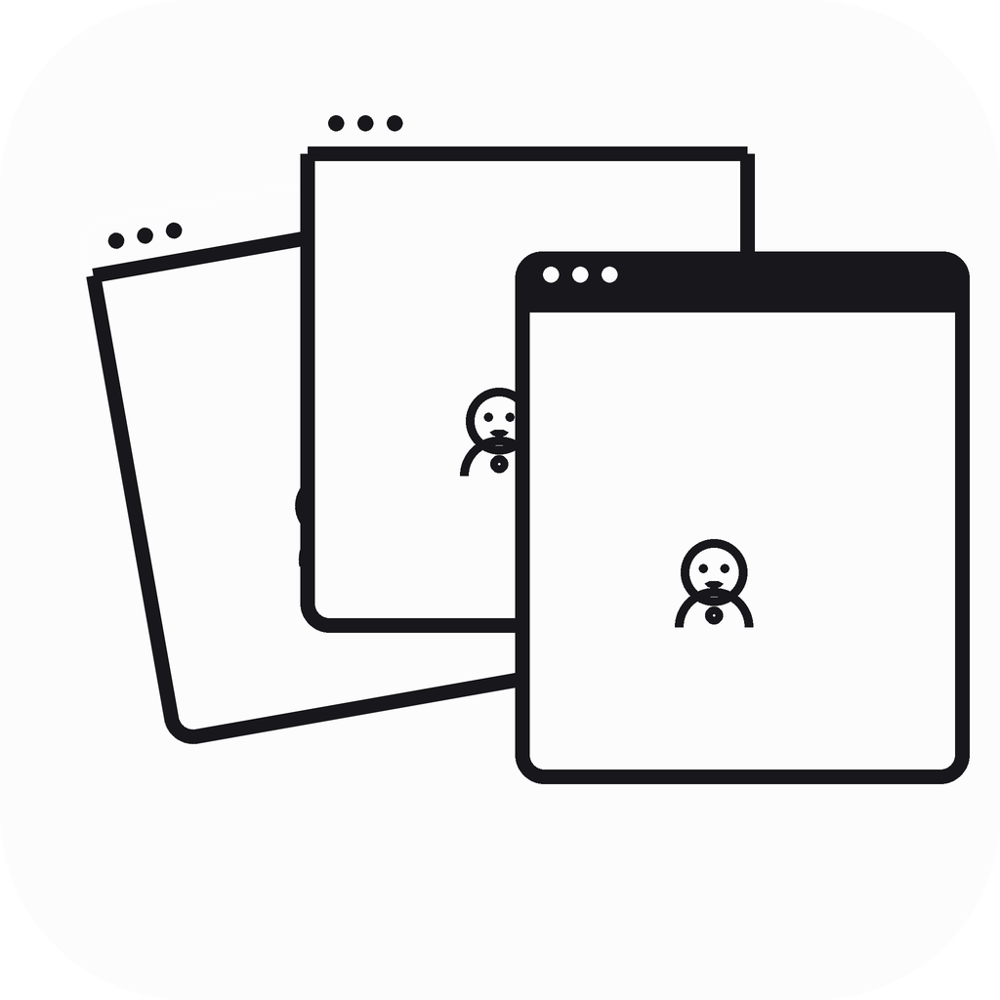
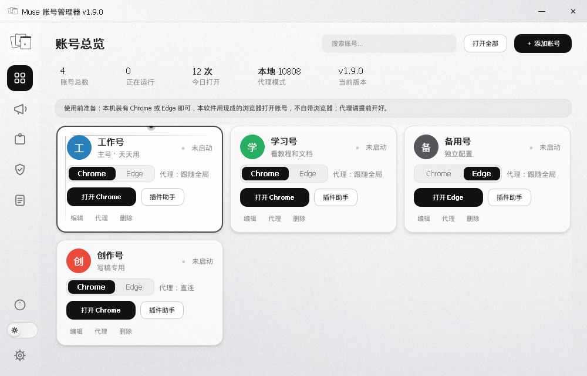
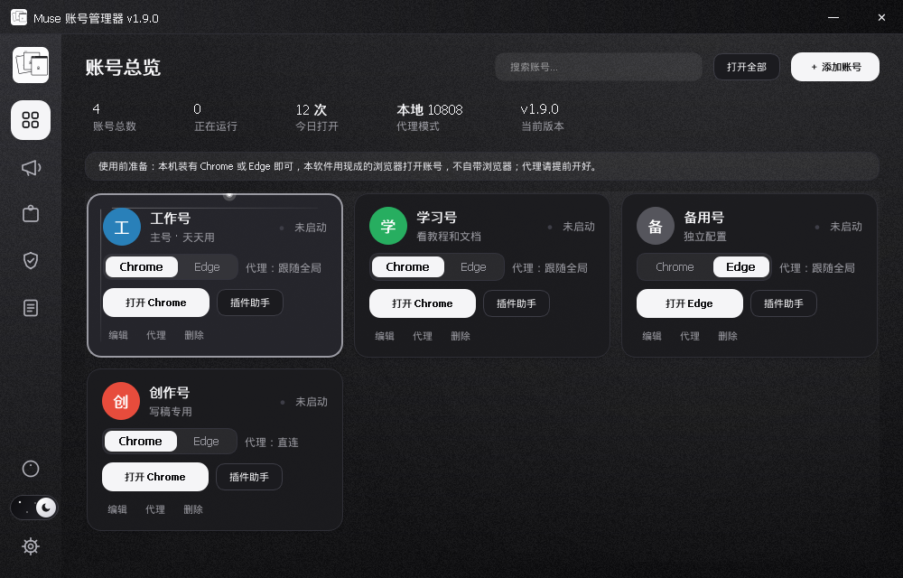
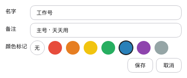
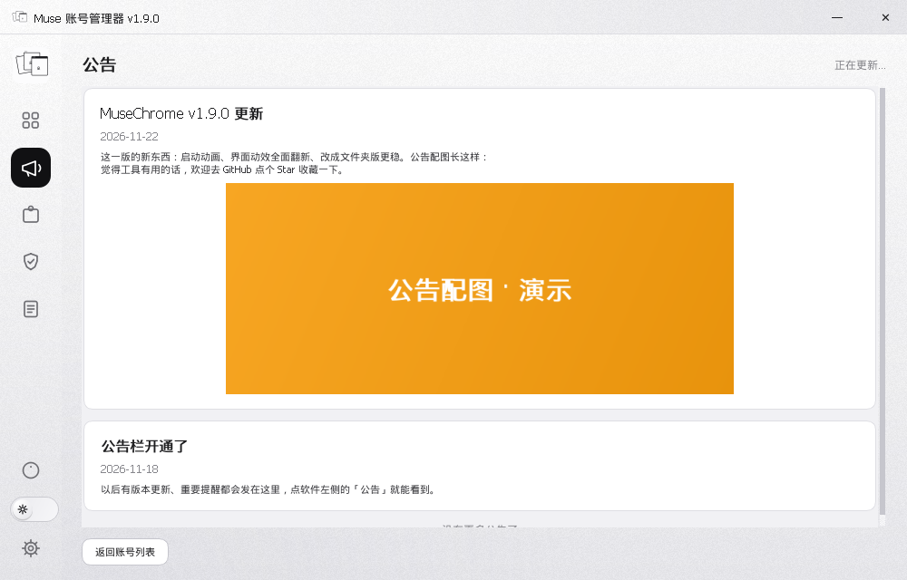
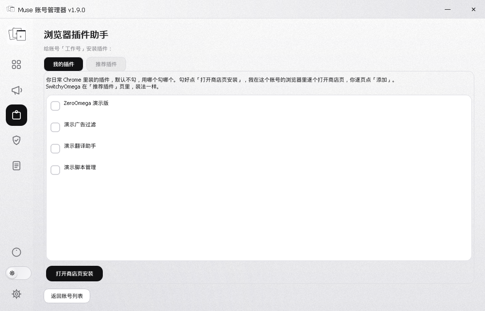
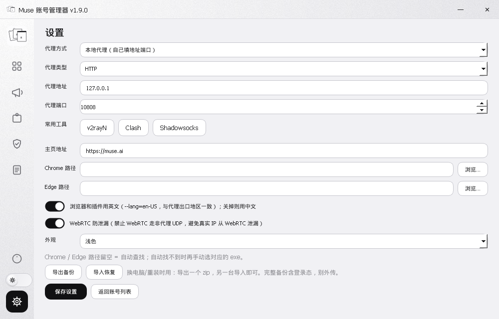
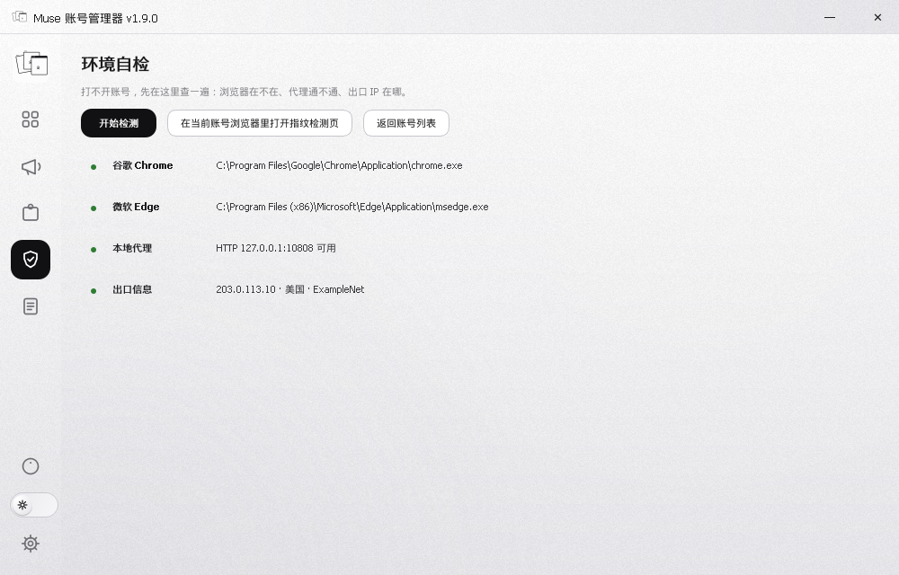
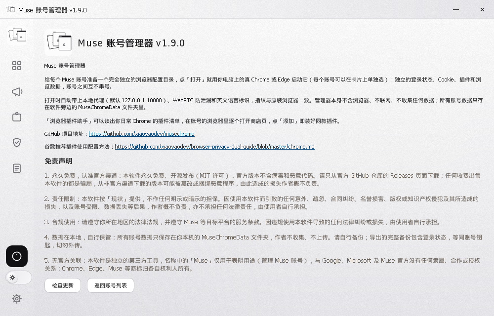

<p align="center">
  
</p>

<h1 align="center">MuseChrome · Muse 账号管理器</h1>

<p align="center">
  
  
  
</p>

给每个 Muse 账号准备一个**完全独立的浏览器配置目录**，点一下就用你电脑上的真 Chrome 或 Edge 打开它（每个账号自己选）：独立的登录状态、Cookie、插件和浏览数据，账号之间互不串号。管理器本身不含浏览器、不收集数据。

适合需要 **Muse 多账号切换、多账号同时登录、防串号** 的人：自媒体运营、多平台账号管理、团队协作等场景，一个账号一套独立浏览器环境，登录一次，点开即用。

## 下载

到 [Releases](../../releases) 下载安装版 `MuseChrome-Setup-v1.9.1.exe`，双击安装（可选安装目录，自动创建桌面快捷方式；未签名，首次运行如遇 SmartScreen 提示，点「更多信息 → 仍要运行」）。也可以下载文件夹版 `MuseChrome-v1.9.1.zip`，解压后双击里面的 `MuseChrome.exe` 免安装运行。

> **从旧版升级**：运行新版安装包、安装目录选你原来程序所在的文件夹即可，程序文件原地替换，`MuseChromeData`（账号数据）不会被动；用文件夹版的话，解压后把旧版旁边的 `MuseChromeData` 拷进新文件夹。v1.9.1 起，软件内「检查更新」会直接下载安装包原地更新，不用再手动。

**使用前准备：本机装有谷歌 Chrome 或微软 Edge 任一浏览器即可**——本软件用你电脑上现成的浏览器打开账号，不自带浏览器；代理请提前开好。

数据保存在 `MuseChrome.exe` 旁边的 `MuseChromeData/` 文件夹里，删掉程序文件不影响数据，搬走整个文件夹即可迁移。

## 功能

- **多账号隔离**：每个账号一个独立的浏览器配置目录（Chrome 在 `MuseChromeData/chrome-profiles/`、Edge 在 `MuseChromeData/edge-profiles/`），登录一次后免登录，重复点「打开」只多开一个窗口、不会串号。卡片上能看到每个账号的打开状态和已打开时长，也能一键关闭它的浏览器；右上角「打开全部」把没打开的账号排队逐个打开（带进度和卡片动画），不用一个个点。
- **账号备注与颜色标记**：卡片上的「编辑」可以给每个账号写一句备注、选一个颜色（卡片头像底色），账号多了靠备注和颜色认号。
- **启动动画与界面动效**：打开软件有 3 秒启动动画（毛玻璃卡化作颗粒散开、主页淡入、「欢迎使用」字样浮现），点一下可跳过；按钮、卡片、开关都带细腻的悬停/按下动效，选中的卡片有亮点沿边框绕行。
- **深色外观**：默认浅色，边栏下方日夜开关一键原地切换浅色 / 深色（设置里也能选），晚上用不刺眼。
- **Chrome / Edge 双支持**：每个账号在卡片上单独选浏览器，哪个账号用 Chrome、哪个用 Edge 互不影响；两个浏览器同等待遇（独立配置、代理、防泄漏、英文标识）。
- **代理三模式**：本地代理（默认 HTTP `127.0.0.1:10808`，设置里有 v2rayN / Clash / Shadowsocks 预设按钮）、跟随系统代理（用 Clash 等开了系统代理的工具时选）、直连（开了 TUN 时选）。**每个账号还能单独指定代理**（卡片上的「代理」按钮），几个账号可以各走各的出口。
- **防泄漏**：启动时带上 WebRTC 防泄漏参数（禁止走非代理 UDP）和英文语言标识（`--lang=en-US`），均可在设置里开关。
- **公告栏**：左侧「公告」页显示作者发布的更新与提醒（软件启动时从作者的 Gitee 仓库拉取，有新公告时按钮会标「新」），公告正文里可以带图片。
- **环境自检**：打不开账号先查这里——浏览器在不在、代理通不通（真发请求探活）、代理延迟、填的端口不通时自动扫描常见代理端口并可一键改用、出口 IP 与地区，一页看清。
- **插件助手**：读出你日常 Chrome 已装的插件清单，在账号选定的浏览器里逐个打开它们的商店页，点「添加」即装好同款插件（装一次永久保留）；另有内置的推荐插件包，可离线直接装。代理类插件（如 SwitchyOmega）默认不勾选——代理已由管理器接管，避免冲突。推荐插件的具体用法和配置方法见作者另一个项目 [browser-privacy-dual-guide](https://github.com/xiaoyaodev/browser-privacy-dual-guide)。
- **备份 / 恢复**：设置里一键导出 zip 备份（轻量：账号＋设置；完整：连每个账号的登录态，换电脑导入免登录），导入前会自动留一份当前数据的副本。
- **检查更新**：左侧边栏一键检查 GitHub 最新版本（走软件里配置的代理）；发现新版后直接在软件里下载安装包、校验，自动关闭软件并原地替换程序文件（账号数据保留），装完自动重新打开。

## 截图

截图中均为演示账号与演示数据，不是任何人的真实清单。

| 主界面（浅色，默认） | 深色外观 |
| --- | --- |
|  |  |
| 账号编辑（写备注、选颜色标记） | 公告（可以带图片） |
|  |  |
| 插件助手（逐个打开商店页安装） | 设置（代理三模式＋常用工具预设） |
|  |  |
| 环境自检（浏览器、代理、出口信息） | 关于软件 |
|  |  |

## 使用要点

- 本机装有谷歌 Chrome 或微软 Edge 任一浏览器即可，软件不自带浏览器，用的是你电脑上现成的浏览器。
- 每个账号第一次用某个浏览器打开是全新环境，登录一次 Muse 即可；Chrome 和 Edge 各用各的配置目录，同一账号在两个浏览器里要各登录一次。
- 改了代理/语言等启动参数后，要把该账号的浏览器窗口全部关掉再重新打开才生效。
- 打不开账号时先去「环境自检」页查一遍，多数问题是代理工具没开或端口对不上。
- 插件的个人设置不会从日常 Chrome 带过来，新装后按需在各账号里设置一次。

## 从源码构建

需要 Python 3.11 + PyQt6 + PyInstaller（Windows）：

```bat
pip install PyQt6 PyInstaller
pyinstaller MuseChrome.spec
```

产物在 `dist/MuseChrome/` 文件夹（`MuseChrome.exe` ＋ `_internal/`）。

注：发布包里内置的推荐插件包放在 `assets/extensions/`（各插件官方发布的文件，体积较大），没有随源码仓库一起发布；从源码构建时把对应插件的官方包按同名目录放回该处即可，不放也能构建运行，只是没有离线插件包。

## 目录结构

```
main.py            入口
musechrome/        主程序（mainwin.py 主窗口、cards.py 账号卡片、dialogs.py 对话框、
                   splash.py 启动动画、fxbuttons.py / themeswitch.py / widgets.py 动效组件、
                   pages.py 各功能页、store.py 配置与启动逻辑、updater.py 检查更新、
                   notices.py 公告、extensions.py 插件助手、health.py 环境自检、
                   applog.py / logpage.py 日志、theme.py 外观、icons.py / iconutil.py 图标、
                   netutil.py 网络）
tests/             纯逻辑测试（python tests/test_store.py）
assets/            图标与证书（extensions/ 内置插件包未随仓库发布，见上）
docs/              README 截图（均为演示数据）
MuseChrome.spec    PyInstaller 打包配置（文件夹版）
installer.nsi      安装版脚本（文件夹版整包安装，升级保留账号数据）
```

## 免责声明

1. **永久免费，认准官方渠道**：本软件永久免费、开源发布（MIT 许可），官方版本不含病毒和恶意代码。请只从本仓库的 Releases 页面下载；任何收费出售本软件的都是骗局，从非官方渠道下载的版本可能被篡改或捆绑恶意程序，由此造成的损失作者概不负责。
2. **责任限制**：本软件按「现状」提供，不作任何明示或暗示的担保。因使用本软件而引致的任何意外、疏忽、合同纠纷、名誉损害、版权或知识产权侵犯及其所造成的损失，以及账号受限、数据丢失等后果，作者概不负责，亦不承担任何法律责任，由使用者自行承担。
3. **合规使用**：请遵守你所在地区的法律法规，并遵守 Muse 等目标平台的服务条款。因违规使用本软件导致的任何法律纠纷或损失，由使用者自行承担。
4. **数据在本地，自行保管**：所有账号数据只保存在你本机的 `MuseChromeData` 文件夹，作者不收集、不上传。请自行备份；导出的完整备份包含登录状态，等同账号钥匙，切勿外传。
5. **无官方关联**：本软件是独立的第三方工具，名称中的「Muse」仅用于表明用途（管理 Muse 账号），与 Google、Microsoft 及 Muse 官方没有任何隶属、合作或授权关系；Chrome、Edge、Muse 等商标归各自权利人所有。

## 更新记录

**v1.9.1**
- 新增：安装版回归并作为主下载——双击安装、可选目录、桌面快捷方式与开始菜单、带卸载（卸载不删账号数据）；升级安装只替换程序文件，账号数据原样保留。
- 改进：软件内更新改走安装包——检查更新发现新版后下载安装包，自动原地替换并重新打开；同时修掉旧更新器在只有 zip 的版本上拼错下载地址、报 404 的问题。

**v1.9.0**
- 新增：启动动画——打开软件先播 3 秒动画（毛玻璃卡化成颗粒散开、主页淡入、「欢迎使用」字样浮现），点一下可跳过，动画异常时自动直进主页。
- 新增：日夜开关——边栏下方的外观切换换成日夜开关，点一下原地切换深浅，不再重启软件。
- 改版：打包从单文件 exe 改成文件夹版（单文件版在一些机器上会报「解释器启动失败」），解压即用，启动更快；本版暂不提供安装版，旧版升级需手动一次（见「下载」一节）。
- 优化：默认浅色外观；窗口固定 1000×640。
- 优化：界面动效整体翻新（动效语言借开源组件库 Uiverse，Qt 原生重写，配色仍是黑白灰）——「添加账号」悬停圆点汇聚淹成反色、普通按钮按下回弹＋悬停扫光、选中卡片亮点沿边框绕行＋悬停软影抬起、开关滑动与对勾描画、切页淡入。
- 优化：视觉层级收紧——圆角分级（主按钮 12px / 卡片 16px / 小按钮 8px）、标题字重降档、统计数字 20px → 15px、横幅与说明文案压短、背景柔光减淡、卡片区换带颗粒的毛玻璃底、选中卡边框改柔和灰。
- 优化：设置页整体收紧并装进滚动区，不再溢出；「常用工具」预设按钮在行里居中，不再贴下边框。
- 优化：插件助手推荐插件改成默认不勾选；勾选状态切页回来不再丢失。
- 修复：鼠标划过左侧图标栏时日志反复刷 `_flood` 报错的问题（动画收尾代码误粘到图标按钮上，不影响使用）。

**v1.8.1**
- 修复：点边栏「🌙 深色外观」切换外观时闪退（连续点击更容易触发）；切换机制改为存好设置后自动重启软件进程，窗口位置保持不变，已经打开的浏览器窗口不受影响。

**v1.8.0**
- 新增：批量打开（右上角「打开全部」排队逐个打开未开的账号，带进度提示与卡片脉冲动画；账号卡片首次出现时错落淡入）。
- 新增：账号备注与颜色标记（卡片「编辑」里填写，备注显示在卡片上，颜色用作头像底色）。
- 新增：深色外观（边栏下方月亮按钮一键切换，立即生效；设置里也能选）。
- 新增：公告支持图片（正文里单独一行图片地址即可，软件自动下载缓存并显示）。
- 改进：环境自检新增「代理延迟」一项（经代理取测试页的往返时间，仅供参考，可能有误差）。
- 改进：账号卡片排版——账号总数不满 3 个时卡片自动拉宽铺满整排，不留大块空白。
- 修复：深色外观下环境自检、插件助手页面部分文字看不清的问题。

<details>
<summary>更早版本（v1.7.3 及以前）</summary>

**v1.7.3**
- 修复：环境自检第一次检测容易把可用代理误报成超时不可用（冷连接经远端节点建连超过 3 秒）；探活放宽到 8 秒、失败自动重试一次，协议设错时会自动换另一种协议再探并提示改法。

**v1.7.2**
- 「关于软件」页和 README 新增免责声明（永久免费与官方渠道、责任限制、合规使用、数据保管、无官方关联）。

**v1.7.1**
- 修复：公告栏把两条公告黏成一条显示的问题（公告文件是 Windows 换行 CRLF 时分隔符识别失效；解析前先统一换行，并加了回归测试）。

**v1.7.0**
- 新功能：公告栏——左侧新增「公告」页，显示作者发布的更新与提醒，有新公告时按钮标「新」。
- 新功能：支持微软 Edge——每个账号可在卡片上单独选 Chrome 或 Edge，Edge 同样有独立配置目录、代理、WebRTC 防泄漏和英文标识。
- 新功能：每个账号可单独指定代理（跟随全局 / 直连 / 自己的地址端口），几个账号可以各走各的出口 IP。
- 新功能：代理方式改为三模式——本地代理（新增 v2rayN / Clash / Shadowsocks 预设按钮）、跟随系统代理、直连（TUN）；不再只认 v2rayN 的端口。
- 新功能：环境自检页——查浏览器在不在、代理通不通、自动扫描常见代理端口并可一键改用、显示出口 IP 与地区。
- 新功能：备份 / 恢复——设置里导出 zip（轻量或含登录态的完整备份），换电脑导入即可；导入前自动保留当前数据副本。
- 新功能：卡片显示账号已打开时长，并可一键关闭该账号的浏览器。
- 新图标：软件图标换新（三窗叠放造型）。
- 修复：公告页在有公告时会残留一行「暂无公告」文字的问题。

**v1.6.1**
- 新增安装版：双击安装、可选安装目录、自动创建桌面快捷方式和开始菜单项，带卸载程序（卸载不删账号数据）；程序文件名固定为 MuseChrome.exe，软件内更新原地覆盖，快捷方式不受影响。
- 修复：账号卡片「已打开」状态改为实时跟踪 Chrome 进程——关掉浏览器后几秒内自动变回「未打开」，不再一直显示已打开。
- 修复：便携版软件内更新后文件名不变的问题（新版以新文件名落地、自动删旧文件）；更新后首次启动加了延时，避开杀毒扫描高峰导致的 DLL 加载失败。
- 修正：设置页「WebRTC 防泄漏」「英文语言标识」两处说明文字改成准确的功能描述，不再预设使用者的其他软件设置。

**v1.6.0**
- 改版：设置、插件助手、关于软件从独立弹窗改成主区里的页面，点边栏直接切换；边栏同一时刻只亮当前页一个按钮。
- 修复：打开设置等弹窗时边栏出现两个按钮同时亮橙的问题（就是上条改版的原因）。

**v1.5.0**
- 新功能：软件内更新——点「检查更新」发现新版后可直接在软件里下载，校验通过后自动替换并重启，不用再去网页下载。
- 修复：插件助手名单在 Windows 深色模式下文字变白、看不见插件名的问题（名单文字颜色写死并强制浅色显示）。
- 修复：左侧边栏按钮点击没有反馈的问题（已加按下变色，打开对话框期间对应按钮保持高亮）。

**v1.4.0**
- 新界面：左侧深色边栏导航 + 账号卡片网格；主区顶部提示条标注「本机一定要有谷歌浏览器（Chrome）」。

</details>

## English

MuseChrome is a free, open-source Windows desktop app for managing multiple Muse accounts. Each Muse account gets its own isolated browser profile — separate cookies, logins, extensions and browsing data — launched with your real Chrome or Microsoft Edge (chosen per account): no account mixing, no repeated sign-ins.

Features: per-account Chrome/Edge profiles, flexible proxy support (local proxy with presets for common tools, follow-system-proxy, or direct/TUN mode, plus optional per-account proxy overrides), WebRTC leak protection, an in-app announcement board, a built-in environment self-check (browser presence, proxy reachability, common-port scan, exit-IP info), backup/restore, an extension helper that re-installs your everyday Chrome extensions into each account profile, and built-in update checks. A Muse multi-account manager and account switcher for creators and teams who run several Muse accounts side by side.

## 代码签名

本项目的发布文件目前未进行代码签名，Windows 可能会显示「发布者未知」并弹出 SmartScreen 提示。发布文件均由本仓库公开源码构建，请只从本仓库 Releases 页面下载，确认来源后选择「仍要运行」继续安装。

## 隐私

This program will not transfer any information to other networked systems unless specifically requested by the user or the person installing or operating it.（本程序不收集、不上传任何账号数据；账号数据只保存在本机 MuseChromeData 文件夹。联网行为只有三处，都是只下载不上传：启动时从作者的 Gitee 仓库拉取公告文本、使用者点击「检查更新」时连接 GitHub、使用者点击「环境自检」时查询出口 IP 信息。程序启动的浏览器是使用者本机安装的 Chrome / Edge，其隐私政策见对应厂商的相关说明。）

## 许可

MIT License，见 [LICENSE](LICENSE)。
